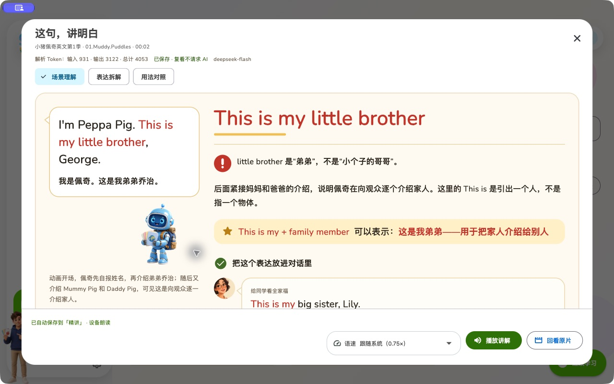
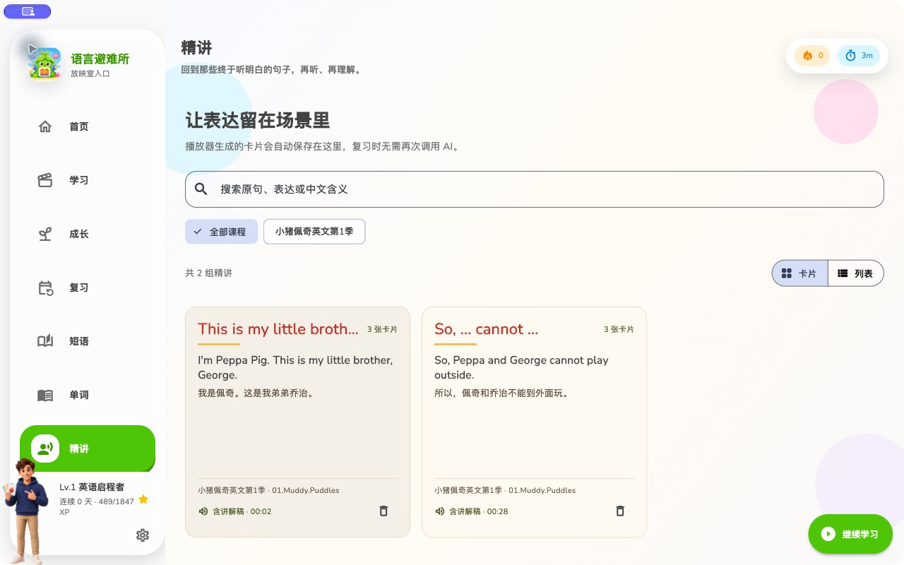
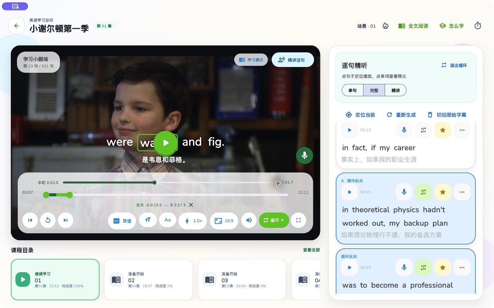
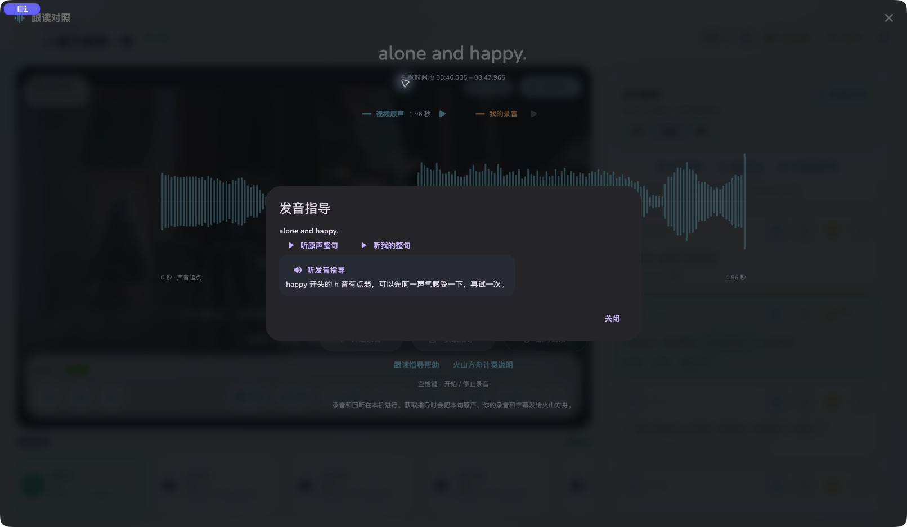
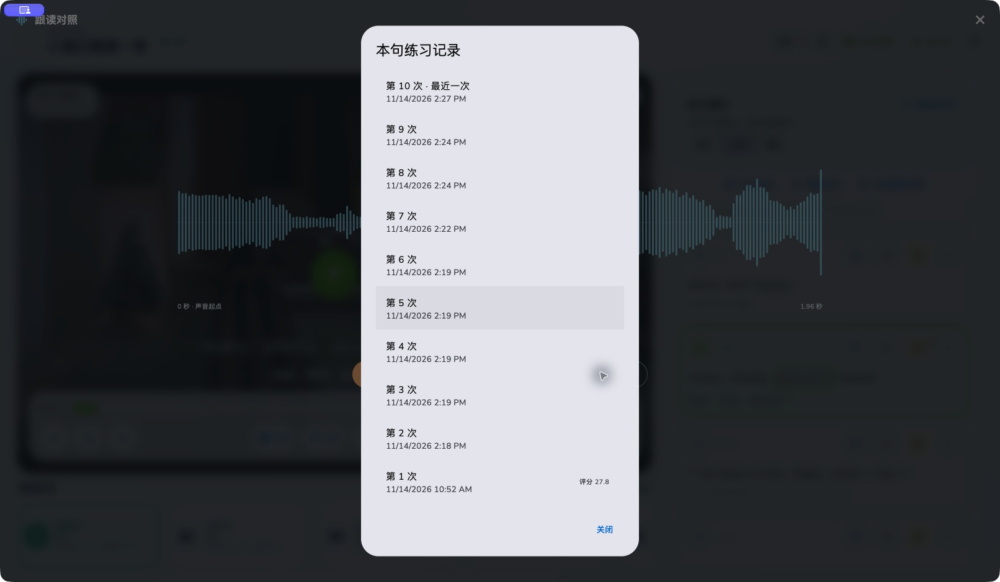

<p align="center">
  
</p>

<h1 align="center">Shadowing English</h1>

> A local-first English shadowing app for listening and speaking practice with your own videos and subtitles.

> 使用自己的视频和字幕，通过逐句精听、重复播放和影子跟读练习英语听力与口语。

English · [中文](README.md)

[](LICENSE)
[](https://github.com/TideSparrow/shadowing-english/actions/workflows/lint.yaml)
[](.fvmrc)
[](https://github.com/TideSparrow/shadowing-english/releases/latest)
[](https://github.com/TideSparrow/shadowing-english/releases/latest)
[](https://github.com/TideSparrow/shadowing-english/stargazers)
[](https://github.com/TideSparrow/shadowing-english/issues)
[](https://buymeacoffee.com/marklongpcm)

[Download the latest release](https://github.com/TideSparrow/shadowing-english/releases/latest) · [Subtitle guide](#subtitles-from-import-to-word-level-shadowing) · [Subtitle lessons & Token costs](#saved-subtitle-lessons) · [Run from source](#run-from-source) · [Import learning materials](#import-learning-materials)

**Future features**: Improve study, review, and video navigation first, then expand contextual vocabulary learning, illustrated cards, IELTS reference-list coverage tasks, and dialogue practice with recording and dubbing. [Read the roadmap and implementation order (Chinese)](ROADMAP.md). These are planned improvements, not released features.

Reference for future planning: [Everyone Can Use English / Enjoy](https://github.com/ZuodaoTech/everyone-can-use-english), focusing on learning methods and AI-assisted practice workflows. Candidate improvements will be evaluated through the roadmap.

## Screenshots

| Sentence-by-sentence player | Import local videos and subtitles |
| :---: | :---: |
|  |  |
| Tap a line, loop the difficult part, and stay with the original scene. | Choose your own media and subtitles, review the matches, then start learning. |
| AI subtitle lessons · Understand the meaning | Lesson library · Save and revisit |
|  |  |
| Explain a line using nearby dialogue, including pitfalls and examples. New analysis consumes your model's Tokens. | Cards are saved locally and reopening them makes no AI request. Switch between cards and lists; pagination appears above 24 groups. |
| Word lookup in context | Full transcript, synced with playback |
|  |  |
| Tap a subtitle word for its meaning, sentence context, saving, and pronunciation. | Open the complete word-by-word transcript; playback keeps the current sentence and word in view. |
| Tap words in video subtitles | |
|  | |
| Look up a word directly from the subtitle over the playing video. | |
| The three-pass method | Learning journey and levels |
|  |  |
| Understand first, listen closely, then shadow the line. | Track practice, gain experience, and see the next step clearly. |
| Wordbook | Saved phrases |
|  |  |
| Keep useful words connected to their context for review. | Save expressions that deserve more speaking practice. |
| Subtitle, translation, and playback settings | |
|  | |
| Configure support around the way you study. | |

Shadowing English is an English shadowing app for turning videos you already own into deliberate listening and speaking practice. Import local videos and subtitles, work through real scenes sentence by sentence, and keep your media on your own device. This project does not provide videos, courses, or subtitle packs.

## What is Shadowing English

English shadowing is more than repeating a line once. It puts listening and speaking in the same real-video context: understand the scene, identify what you hear, then imitate the speaker's timing, connected speech, intonation, and pronunciation.

Use the videos you genuinely want to watch as subtitle-based English learning material. Saved words and phrases stay connected to the original scene instead of becoming an isolated list.

## How the shadowing method works

1. **Understand**: Use bilingual subtitles to grasp the scene, context, and emotion.
2. **Listen**: Switch to English subtitles, navigate sentence by sentence, and replay difficult lines.
3. **Shadow**: Reduce subtitle support and imitate the speaker's rhythm, linking, stress, intonation, and pronunciation.

Short loops keep auditory recognition and spoken output together. A few lines at a time can move you from reading subtitles to understanding and saying the line yourself.

## Key features

- **Local video import**: Build a personal library from video folders on your device.
- **Course resource directories**: View video and subtitle locations from a course card or its details. On desktop, preview and relink moved folders while retaining learning progress and vocabulary; missing episodes stay in the library, and new videos are imported only when selected.
- **Subtitle import and matching**: Import `.srt` or `.vtt` files; match subtitles to videos from filenames and episode markers.
- **Sentence-level navigation**: Tap a subtitle line to jump to the right point in the video.
- **Single-sentence and A–B looping**. Repeat a single line or loop a stretch of dialogue by setting A/B points or selecting consecutive subtitles. The subtitle selection and timeline endpoints stay in sync. [See the screenshot and instructions](#ab-looping).
- **Subtitle modes**: Switch among English, bilingual, and hidden subtitles as you progress.
- **Word lookup from subtitles**: Tap a word for its definition while it is still in context.
- **Full word-by-word transcript**: The active sentence and word follow playback in the complete transcript reader.
- **Tap words in video subtitles**: Look up words directly from the subtitle over the video.
- **Saved words and phrases**: Keep useful vocabulary and expressions in dedicated review spaces. Reconnect historical words to reimported videos at their original timestamps; context sentences follow subtitle letter-case settings while preserving the original text.
- **Anki export**: Export saved words and phrases as a ready-to-import `.apkg` deck or TSV/CSV, including pronunciation, meaning, multiple subtitle contexts, translations, and episode timestamps. English contexts and phrases follow the subtitle letter-case setting at export time; saved originals remain unchanged.
- **Shadowing practice**: Record each shadowing session as part of your learning activity.
- **Learning progress**: Track study time, sentences, phrases, course progress, levels, and achievements.
- **Optional AI subtitles**: Generate or switch subtitles for videos without them using your own provider configuration.
- **AI subtitle lessons (consume Tokens)**: Explain the current utterance using nearby dialogue, with three automatically saved cards covering context, expressions, and usage. [How to use lessons and understand Token costs](#saved-subtitle-lessons).
- **Local first**: Your videos, subtitles, and learning records remain centered on your device.

## AB looping

Loop a few consecutive lines of dialogue to practice connected speech, intonation, and shadowing. The player's **循环** (Loop) menu offers both single-sentence and A–B looping.



- **Set a range in the player.** Open **循环** (Loop) → **AB 区间循环** (A–B loop). Use the upper **本轮** (Current loop) bar to see how far the loop has played or seek within it. Drag either round A/B handle on the lower timeline to adjust the range, even down to a short sentence. By default, A is the start of the current subtitle. B is about two minutes after A, or at the end of the video if it comes sooner.
- **Select a range from subtitles.** Click **选择循环区间** (Select loop range) in the blue header above the subtitle list. Select the first and last lines. Every line between them is included automatically. Click **完成选择** (Done selecting) and start playback. The timeline reflects your selection, and the same button becomes **退出循环** (Exit loop).
- **Fine-tune or exit.** Dragging either endpoint pauses playback and previews the boundary in the video and subtitles. The highlighted lines update as you drag. Click **×** or **退出循环** (Exit loop) to return to A and restore the regular progress bar.

A–B looping works in landscape, portrait, and fullscreen, and the selection survives screen rotation. Playback jumps back to A when it reaches B. To repeat just one sentence, use the loop button beside that subtitle line.

The `.apkg` templates provide live English pronunciation on both sides without bundling audio files. Official Anki clients use native TTS. Web clients that allow card scripts and provide the Web Speech API show a replay button using a local English voice, without external speech API calls. Clients that block scripts or lack an English voice cannot provide playback; unsupported TTS syntax stays hidden. Native TTS requires Anki 2.1.20+, AnkiMobile 2.0.56+, or AnkiDroid 2.17+; Linux needs a TTS add-on. Re-export and re-import older decks with template updates enabled.

## Subtitles: from import to word-level shadowing

Shadowing English does more than display one subtitle line over a video. It turns subtitles into a learning timeline you can navigate, loop, search, and shadow. Choose the workflow that fits your material:

- **Import external subtitles**: `.srt` and `.vtt` files are supported. This is the most direct option when you already have good subtitles; English and Chinese tracks can be matched automatically by filename.
- **Switch embedded subtitle tracks**: If a video contains selectable subtitle tracks, choose one from the player's subtitle menu without extracting it first.
- **Generate word-level synced subtitles with AI**: When no subtitle is available, or an existing subtitle only has sentence-level timing, AI can analyze the audio and create start and end times for each English word.

### How to use AI subtitles

1. Open Settings and find “AI生成可跟读的词级同步字幕” (AI-generated word-level synced subtitles). Select an ASR provider and enter your own API key. Alibaba Cloud Model Studio is the default, and the other providers listed in Settings are also supported.
2. Keep “生成双语字幕” (Generate bilingual subtitles) enabled and configure a translation service if you want English and Chinese. Turn it off if you only need English.
3. Import and play a video, then select “AI生成可跟读的词级同步字幕” in the player. The app shows recognition progress while it works.
4. Once complete, the subtitle is stored locally and loaded for playback. Open Settings → “管理 AI 字幕” (Manage AI subtitles) to review it, edit individual words, export it, regenerate it, or delete it.

Generation calls the third-party services you select and may incur a small charge. Enter API keys only in the app's settings; never commit them to the repository or expose them in screenshots or public logs.

### How it works

```text
Local video
  → extract and split audio on the device
  → recognize English and word timestamps through an ASR service
  → merge, validate, and repair the timeline locally
  → optionally generate Chinese translations
  → save locally and highlight each word during playback
```

When usable English external or embedded subtitles are available, the app can use them as a reference: the more complete source text is preserved while speech recognition supplies or calibrates word timing. Reference subtitles are not silently overwritten, and the app reports when recognition results or timestamps require repair. Without a reference, the English text and timeline are generated directly from the video's audio.

### Why it is better than ordinary subtitles

- **Word-level sync, not only sentence-level sync**: The active word follows playback, making connected speech, reductions, and stress easier to notice.
- **Subtitles become learning controls**: Tap a sentence to seek, loop a difficult line, look up a word, or follow the current position in the full transcript reader.
- **Existing subtitles remain valuable**: A reliable source subtitle can provide the text while AI focuses on word timing, reducing omissions and transcription mistakes.
- **Generated results stay manageable**: Subtitles are stored locally and can be edited, exported, regenerated, or deleted without calling the service every time you play the video.
- **Usable results are preserved where possible**: Common timestamp overlaps and missing word timings are repaired locally. If Chinese translation is incomplete, the generated English subtitle is kept whenever possible.

AI recognition can still be affected by background music, overlapping speakers, accents, and recording quality. For important material, use an existing subtitle as a reference and review the result in Manage AI Subtitles before relying on it long-term.

## Saved subtitle lessons

When you recognize every word but still miss the speaker's meaning, use nearby dialogue to understand the whole utterance, its key expression, and common pitfalls. Situated examples help you use the expression elsewhere.

**New analysis consumes Tokens from your own configured language-model account and may incur provider charges. Saved cards can be reviewed locally.**

[View the actual lesson dialog](assets/showcase/lesson-dialog.jpg) · [View the actual lesson library](assets/showcase/lesson-library.jpg)

### How to use it

1. **Configure AI**: Open Settings → Translation (设置 → 翻译), choose a language-model provider, and enter your API key, endpoint, and model. Ordinary machine-translation APIs cannot generate lessons. Without a configured model, no analysis request is sent.
2. **Explain the current line**: Play a video with English subtitles and click **精讲这句** (Explain this line) at the upper right of the player, or choose the same action from a subtitle's menu. Playback pauses. If the lesson is not already saved, clicking sends an AI request to complete and explain the current utterance using nearby dialogue.
3. **Read the three cards**: Switch among **场景理解** (Context), **表达拆解** (Expression), and **用法对照** (Usage) for a natural translation, the reasoning behind an expression, and examples in other situations. The header shows the provider's reported input, output, and total Tokens.
4. **Listen to the explanation**: Click **播放讲解** (Play explanation) for bilingual device narration that advances through the cards. The adjacent **语速** (Speed) control follows the app's speech setting by default; an independent 0.5×–3× setting is remembered. Changes during playback take effect on the next segment. You can stop, read the script, or return to the source video.
5. **Review later**: Successful lessons are saved automatically. Reopen them from the global **精讲** library or the player's **精讲** sidebar tab. The library defaults to cards with a list toggle and 24 groups per page; search and course filters cover all saved lessons. Small illustrations are bundled, with no separate image generation required.

### Tokens and costs

| Action | Does it consume lesson Tokens? |
| --- | --- |
| Generate a lesson that has not been saved | **Yes.** Tutor instructions and nearby subtitle context are input; three cards and narration scripts are output. Both use your model account's quota. |
| Click Retry after an unsuccessful analysis | A new AI request is sent and may consume more Tokens and incur additional charges. |
| Reopen saved cards, search, filter, or change pages | **No.** These actions read local content. |
| Play an existing narration script, change speed, or display bundled illustrations | **No.** These use device speech and bundled images, without a lesson-model request. |

Your configured provider and model determine quota and billing rules. Context length and generated content affect consumption; there is no fixed price per lesson group. The header records usage actually returned by the provider. **Missing usage does not mean zero Tokens.** The screenshot shows a historical record for that particular analysis, not a fixed allowance.

Changed source subtitles or surrounding context, or generating again after deleting a saved lesson, creates a new AI request. There is no background pre-generation or automatic retry. Closing cancels the client request, but provider processing already started may still be billed. AI subtitle generation is a separate service with its own provider's usage rules.

Imported, AI-generated, and extractable embedded English text subtitles are supported. Embedded extraction requires local FFmpeg; bitmap and burned-in captions require imported or AI-generated subtitles first. Analysis sends only selected subtitle text and surrounding context, not video. Interpretations use subtitles alone and should be checked against the original scene; invented examples and decorative illustrations are not facts from the video.

## Why use Shadowing English

- **Start with videos you want to watch**: Learn English with videos you care about instead of a fixed course pack.
- **Keep language in context**: Words, lines, and phrases come from real dialogue.
- **Repeat the exact sentence**: Sentence navigation and loops support focused English listening practice and shadowing practice.
- **Practice listening and speaking together**: Understand first, then shadow the line, rather than leaving speaking for later.
- **Keep control of your material**: Local videos and subtitles are not collected or distributed by this project.

## Getting started

### Download

The [latest stable release](https://github.com/TideSparrow/shadowing-english/releases/latest) includes packages for:

- Android: APK
- macOS: DMG
- Linux: x64 `.tar.gz`
- Windows: x64 `.zip`

Visit [Releases](https://github.com/TideSparrow/shadowing-english/releases/latest) to download the package for your platform.

Starting with v0.1.2, each release includes `SHA256SUMS.txt` to verify downloaded files.

Local shadowing recording, playback, and waveform comparison do not require an assessment API key. The Linux desktop build requires `libsecret-1-0`; source builds also require `libsecret-1-dev`. Microphone recording requires `pulseaudio-utils` (for `parecord` and `pactl`) and a running PulseAudio service; PipeWire setups need PulseAudio compatibility enabled.

### Shadowing coaching

Enable [Doubao Seed 2.1 Lite](https://ark.volcengine.com/region:cn-beijing/openManagement) on Volcengine Ark, then enter your [API key](https://ark.volcengine.com/region:cn-beijing/apiKey) in the shadowing coaching settings. After recording, request guidance to send the English subtitle, video excerpt, and your recording to Ark. The device reads the returned advice in Chinese. Recordings and guidance can be revisited in local practice history. The recording screen estimates the pay-as-you-go cost before submission. [Setup guide](README.md#跟读指导) · [Ark model pricing](https://docs.volcengine.com/docs/ark/model-pricing?lang=zh)

| Pronunciation feedback | Practice history for one sentence |
| :---: | :---: |
|  |  |

### Run from source

Flutter 3.44.4 is required. FVM and VS Code are optional; FVM is recommended for pinning the SDK version. To use FVM, [install it](https://fvm.app/documentation/getting-started/installation) first.

```bash
git clone https://github.com/TideSparrow/shadowing-english.git
cd shadowing-english
fvm use 3.44.4
fvm flutter pub get
fvm flutter run
```

In VS Code, install the Flutter and Dart extensions, open the project root, select `Flutter - Prod (select device)` from Run and Debug, then press F5. The project uses the pinned SDK through `.fvm/flutter_sdk`; do not commit machine-specific SDK paths, device IDs, or secrets.

If you use your own Flutter installation, run:

```bash
flutter pub get
flutter run
```

Without VS Code, run `flutter devices`, then `flutter run -d <device-id>` from a terminal. See the [contributor guide](CONTRIBUTING.md) for setup checks, the code map, and entry points for changes.

## Import learning materials

Use matching episode names for video and subtitle files when possible:

```text
Friends-S01E01.mp4
Friends-S01E01.en.srt
Friends-S01E01.zh.srt
```

An English subtitle can also use the exact base name, such as `Friends-S01E01.srt`. The matcher recognizes filename markers including `.en`, `_en`, and `english`. Only import media and subtitles you are allowed to use.

Read [RESOURCE_SETUP.md](RESOURCE_SETUP.md) for more detail. This repository does not include video content, commercial subtitle packs, or unauthorized learning materials.

## Privacy

- Videos, subtitles, and learning records are stored and managed around your local device.
- The project does not host or distribute your course materials.
- If you enable AI subtitles, translation, or subtitle lessons, requests are sent to the third-party provider you configure.

## Contributing

[Issues](https://github.com/TideSparrow/shadowing-english/issues) are welcome, especially for subtitle matching, playback, and cross-platform problems. Please open an Issue before a substantial pull request, and do not submit unauthorized video, subtitle, or course resources.

## Support the project

If Shadowing English helps you practice English, you can [buy me a coffee](https://buymeacoffee.com/marklongpcm) to support maintenance, bug fixes, and improvements.

Support is entirely optional and does not affect access to the app or its MIT license. Stars, issues, and pull requests are also appreciated.

## License

Shadowing English is available under the [MIT License](LICENSE).

For English listening practice, English speaking practice, and English shadowing with local videos, Shadowing English is ready for your own learning library.
